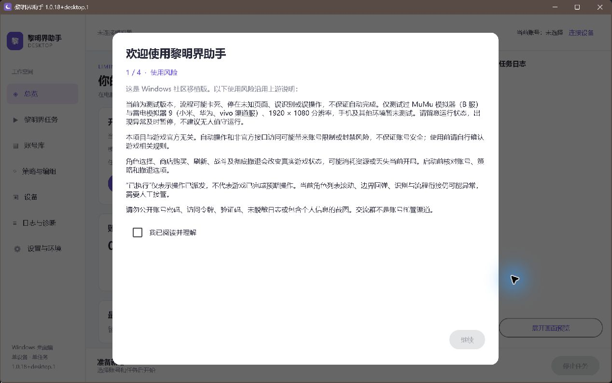

# 黎明界助手 Windows 桌面版交付报告

更新：2026-10-26。**已交付可运行的本地候选版，尚未达到项目全部完成标准。**主要阻断是OCR真实评估低于门槛；标题页实测还确认了上游原有的页面误判。没有将候选包、自检或假设备回放标为真实游戏验收通过。

## desktop.3 验收与 desktop.4 分辨率门槛

用户已确认 desktop.3 的 ADB 体验可接受。该版以 ADB server 直接通信消除高频子进程，并按在线实例合并端口别名；40 项相关测试及只读设备检查通过，见 [ADB 修复与验收记录](reports/ADB-SOCKET-DISCOVERY-FIX.md)。

随后用户提供 Android 12、1280×720 调试包：普通挑战页后缀分数低于原门槛，等待后停止。根据用户要求，本轮采用自动视觉任务启动前强制校验 1920×1080 横屏的统一门槛，撤下两个标题后缀的专用缩放修补，不宣称其他分辨率已普遍兼容。实现及验证记录见 [分辨率运行门槛](reports/RESOLUTION-GUARD.md)。本次没有操作游戏或修改模拟器分辨率。

`8fa21a6` 已统一任务入口、自动触控和界面的真实截图尺寸；14 个相关用例最终通过。覆盖低分辨率启动拒绝、正常横屏截图配合竖屏设备报告、运行中尺寸改变停止及受控重启；尚未用新版执行真实游戏任务。

- [Windows x64 便携候选包 desktop.4](../../desktop/app/build/acceptance-desktop4/dist/LimingjieAssistant-desktop-1.0.18+desktop.4-win-x64.zip) 输出到独立构建目录，保留正在使用的 desktop.3。
- 包含主目录原有、未提交的备用点击坐标兼容修改；该修改的原文件及测试仍完整保留，未混入本轮提交。

另已完成用户要求的多实例源码评估：独立进程配合独立数据目录具备基础，但可靠双开还需要真实设备占用锁、设备与账号绑定、诊断端口分配加固和双实例验证；同进程多控制器受全局服务与截图通道限制。建议先采用独立工作进程，后续可由统一窗口管理。本轮未实现或实测双开。

## 本轮 P1 与 ADB 整合交付

2026-10-25 按用户要求通过两个执行对话实施，并在 `codex/ux-round-2` 合并为 `2c2b1fc`。首页将任务、目标次数与常用参数放在主区域，保存/取消固定在底栏，保留高级配置和启动校验；ADB 统一协调发现与连接、复用已就绪连接、跨页面继续，并移除厂商管理器探测。UI 9 项、ADB 35 项定向检查通过；合并后的首页交互检查和便携包构建通过。ADB 本机只读连接与重复连接复用通过，未操作游戏。

- 当轮 [Windows x64 便携包 desktop.2](../../desktop/app/build/dist/LimingjieAssistant-desktop-1.0.18+desktop.2-win-x64.zip)，内置 Java 21；解压后运行 `LimingjieAssistant.exe`。
- [协调与验证记录](reports/COORDINATION-2026-10-25.md)、[首页改动](reports/P1-HOME.md)、[ADB 改动及实机边界](reports/ADB-CONNECTION-FIX.md)。
- 本地产物包含主目录已有的分辨率兼容修改，原改动仍未提交并完整保留。未覆盖正在运行的旧程序，未推送或公开发布；原生 DPI、真实游戏流程和既有 OCR 限制不因本次构建而视为通过。

## 此前 UI 阶段保留版本

2026-10-25 根据用户提供的 UX 包完成盘点、设计稿及桌面 UI 实现。用户指定 VS Code 默认 Light Modern / Dark Modern，后确认“先改成这样就行了”。当前 `1.0.18+desktop.2` 包含六项导航、运行台、桌面评分、记录、主题和设置；编译、本地应用镜像及相关定向检查通过。实现、检查数量和未验收项见 [UX-VSCODE](reports/UX-VSCODE.md)。

本轮按当前效果收尾，没有生成新的便携 ZIP 或交接包。10 分钟实机性能、完整原生 DPI 矩阵和运行中关闭分支尚未验收；策略外框 Alt+F4 关闭仍需复核。业务算法、Android、OCR 与设备模块保持原实现。下述交付物和详细验证为此前 `desktop.1` 的历史记录，不代表本轮完整验收。

## 此前 desktop.1 交付物

- 版本 `1.0.18+desktop.1`，上游 `b809b196988b019571caf5679ccf8d7ebb7f072d`；保留上游Git历史和共享业务源码。
- [Windows x64便携包](../../desktop/app/build/dist/LimingjieAssistant-desktop-1.0.18+desktop.1-win-x64.zip)，内置Java21，解压后运行 `LimingjieAssistant.exe`。大小 **294085736** 字节（约280.5MiB）。
- [SHA-256文件](../../desktop/app/build/dist/LimingjieAssistant-desktop-1.0.18+desktop.1-win-x64.zip.sha256)：`84b0bbbf788b1ddbabcb0cd6591b4d28667a424f271989b6dbf000216ad4bdb4`。
- [用户说明](../../README-desktop.md)、[实机验收清单](USER_CHECKLIST.md)、[便携包自检结果](evidence/packaging/self-test.json)、[归档结构检查](evidence/packaging/archive-check.json)。

便携包只有一个根目录，包含exe/app/runtime、portable.flag、用户说明与清单、完整许可目录；未包含真实数据目录、测试依赖、开发临时文件或PDB。最终包包含有界OCR补边修复，并重新生成应用镜像和自检；历史包验证记录不冒充新包验证。没有公开发布、创建收费资源或修改旧项目 `D:\WorkSpace\LimingjiePC`。

## 功能与入口

| 功能 | 桌面实现与验证边界 |
|---|---|
| 总览/任务控制 | 桌面导航、状态栏、托盘、暂停/继续/停止、启动与停止互斥；窗口关闭三种选择已接线，真实运行的托盘分支仍列实机清单 |
| 黎明界/刷开局 | 复用原Controller、Workflow、Batch、识别和决策；真实Graph使用假设备/假API完成两轮刷取、首轮不匹配撤退、命中保存、重开读回及自动点击回放 |
| 账号/登录 | 原AccountViewModel及DPAPI加密；新增/编辑/选择/删除/确认、换服和取消均接通。假账号操作实看通过；真实账号登录与Geetest未验收 |
| 策略/编组/评分 | 完整原表单嵌入桌面工作区，保留默认值、合法范围、保存/取消；361角色与头像加载、评分保存重启保持、空槽禁存与放弃草稿通过 |
| 设备/截图/触控 | ADB发现、测速、MaaTouch、兼容模式、前台/节点/设备画像、断线停止与重连不续跑；MuMu12实际连接和触控通过 |
| OCR/存储/协议 | ONNX PP-OCRv5、Room JVM v4、偏好原子文件、Windows DPAPI、上游协议画像和回环验证码；OCR质量未达标 |
| 日志/设置 | 桌面日志与原诊断ZIP、设备画像来源、代理/直连、国服库更新、环境检查与首次向导。不会自动上传诊断 |
| 会战 | 与上游1.0.18一致，不接入导航 |

完整接线表见[UI_PARITY](registers/UI_PARITY.md)、[ASSEMBLY](registers/ASSEMBLY.md)和[线程所有权](registers/THREADING.md)。原型保留在[main-pages.html](design/main-pages.html)，正式界面有实际窗口证据，不用原型代替运行截图。

## 验证结果

| 范围 | 结果 |
|---|---|
| 共享单元/集成 | **1256项：1210通过、46跳过、0遗留失败**。完整检查唯一失败是上游固定版本期待；D-47只派生生成测试中的桌面版本后缀后，失败类定向复跑通过。46项是上游缺本地素材，不计为通过 |
| 设备/平台/app/OCR单测 | 设备32（含新增真实fixture解析）、平台7、app14、OCR17项通过；两项设备fixture时序修正后仅重跑失败项。归并共1326项：1280通过、46跳过。OCR单测通过不代表质量评估通过 |
| 框架/漂移 | 25个框架垫片无JAR同名冲突；同名替身签名、派生命中数、上游耦合与内容漂移、Room v4 identityHash检查通过；测试未修改Android源文件/金标 |
| Android兼容 | lintDebug、testDebugUnitTest、assembleDebug退出0，耗时14分14秒；1247项=1201通过+46素材缺失跳过；lint无Error/Fatal，已有57Warning/2Info保留 |
| 真实窗口 | 默认1280×800/最小1100×700、七个入口、假账号增改取消删、评分保存与重启、编组合法性检查通过；实际便携exe首次向导可显示并正常退出 |
| 本地发行自检 | 中文及空格的解压目录、数据目录、原生库临时目录下退出0，10项全部passed：目录、字体、1074资源、真实OCR样图、SQLite、Room1→4、DPAPI、JNA、MaaTouch、TLS1.3握手 |
| OCR真实质量 | **失败：14/15=93.33%**；商店3/3、详情1/2、堆叠7/7、事件2/2、EX1/1；角色奖励0样本。总体95%与各类85%门槛未满足。p50 23.27ms/p95 151.04ms |
| CI | 三job脚本已实现，但没有可写项目远端及Actions执行记录。云端未验证；OCR gate保留，会阻断check和依赖它的发行job |

证据：[共享完整检查及复跑](evidence/final-tests/)、[Android摘要](evidence/android/result.json)、[WS-B](reports/WS-B-1.md)、[WS-DE](reports/WS-DE-1.md)、[真实Graph](reports/WS-H-device.md)、[OCR](reports/WS-C-1.md)、[窗口操作](reports/UI-1.md)。[退出资源补充](evidence/final-tests/graph-lifecycle.xml)中实际防睡眠VISUAL→IDLE、任务子Job及退出自有scope/线程归零；shutdown连同worker退出35ms。[运行中窗口补查](reports/UI-2-lifecycle.md)因外部关闭模拟器未能完成三分支，未反复重启争用；powercfg查询需管理员权限，未提权。本地构建日志在忽略的 `.tools/`；没有为获得一次绿色全量输出重复已通过的检查。

## 实机范围

本机已达到L1及L2标题页短测条件；完整记录见[L1-MuMu](reports/L1-MuMu.md)。

- MuMu12/API32原实例关闭，按授权启动。真实设备发现、Ready、APK版本/签名、MaaTouch部署/点击/滑动/hold/Back、兼容input模式及hold拒绝、设置应用启动/强停、前台变化与缓存均完成定向验证。
- 600秒连续截图1989帧，起帧间隔p50 **301.21ms**、p95 **302.46ms**，没有断线。该次测速PNG的p50为220ms，低于Raw233ms，因此全程固定PNG。GC后heap约6.70→6.79MB，没有观察到持续大幅增长；不等同于整应用1小时/8小时soak。
- 前台查询20次p50/p95为100.87/128.43ms，Home缓存约210ms更新。系统设置节点树先有idle/null-root失败，官方adb直接调用也失败；一次滚动后恢复，之后20次dump全部成功。此前失败仍保留。
- 最终v5的真实Graph只读20秒处理46帧，有预览；关闭289ms，MaaTouch无残留。B服版本11.7.2/352，停在“点击屏幕开始游戏”，未点击或输入凭据。
- **L2页面识别失败**：1280×720标题动画出现BATTLE_FAILED误判；按推荐1920×1080额外20秒54帧复核仍出现同样误判，因此不是只在低分辨率存在。随后63帧精确抓到5次误判，原始帧与PNG两种解码、102模板及Android原源码/资源行为一致，确认上游纯色检测覆盖标题分类。无战斗上下文时现有分支停止且不点结束/重试；未改识别规则。黎明界内多场景尚需验证。游戏截图包含标识，仅留本机忽略目录。
- 测试实例0最终恢复原关闭状态、720×1280与密度240、无尺寸覆盖。1920复核后的首次恢复因ADB离线失败，随后重启仅用于恢复并核对成功。收尾出现本轮之外的新运行实例3，未干预该实例，保留共享ADB服务以免影响并发使用。实际临时数据留在本机 `.tools/l1-probe`、`.tools/l2-probe`，不进入发行包。

未执行：雷电/Android9、旋转与锁屏组合、12次耗尽重连、真实登录/验证码/渠道SDK、完整游戏循环和游戏长时soak、另一台干净Windows。具体步骤已在随包清单中，不把标题页长时间停留当作游戏soak。

## 正式验收结论与后续条件

| Gate | 正式状态 | 原因 |
|---|---|---|
| G1 | 通过 | 共享源码/兼容/Android验证完成 |
| G2-C | 失败 | OCR质量93.33%，且15/80样本覆盖不足 |
| G2-B/D/E/F | 通过（本机定向范围） | 具体单测、窗口和设备证据见对应报告；真实账号与其他模拟器另列G6 |
| G3 | 未验证（完整严格清单） | 真Graph回放、任务Job结束、原生防睡眠恢复、自有scope/线程退出通过（35ms）；逐行线程及运行中UI关闭完整分支仍缺 |
| G4 | 通过（代表性流程） | 实际窗口、复杂表单和典型编辑流程通过；真实游戏任务归G6 |
| G5 | 未验证（云端部分） | 本地ZIP/自检/启动通过；三个云端job未运行 |
| G6 | 未验证（完整清单） | MuMu L1定向路径通过；标题页有误判，L2/L3游戏闭环未验收 |

因此交付的是候选版，不宣称全部G1–G6通过。下一步需要真实游戏画面与对应实体真值：OCR总量至少80、每类至少8，优先角色奖励、系列计数、小数字；保持原匹配阈值重跑评估。低清数字漏读已修复；系列计数未形成检测框，常规变换未能完整修复且部分引入误读。标题误判已定位为上游原有纯色检测/优先级缺口，按现行边界未改。真实样本还缺65条，具体来源审计见[SAMPLE_AUDIT](../../desktop/ocr/evaluation/SAMPLE_AUDIT.md)。随后在可写项目远端运行CI及剩余L2/L3清单。详见[已知限制](registers/KNOWN_LIMITATIONS.md)。

## 与上游的差异及维护

P-01至P-11均为纯声明/辅助函数搬移或保留Android默认行为的注入（P-07日志源、P-10作用域、P-11 socket），全部登记于[UPSTREAM_PATCHES](registers/UPSTREAM_PATCHES.md)，Android构建已验证。KClass Factory是D-23机械派生；D-47仅处理生成测试的桌面显示后缀。D-45使用现有Skia修复WebP资源；D-46记录v4/v5实测、320宽补边与有界短ROI回退。没有复制旧Python业务或修改上游匹配器、决策阈值。

[回退登记](registers/FALLBACKS.md)逐项列位置/测试：设备重连、截图测速、节点重试、daemon启动、开机轮询、单次触控重启、OCR队列及短ROI回退、坏数据备份、数据库暂存等均有边界；系统浏览器失败和跨电脑DPAPI等未实测分支仍明确记录。没有启用Room JDBC或KCEF备选。真实国服库下载与占用恢复报告见[L2-CnDatabase](reports/L2-CnDatabase.md)：44,163,072字节公开库通过校验，实际SQLite占用触发暂存，新JVM安装并保留旧库备份，恢复阶段零网络请求。

按[上游同步流程](registers/UPSTREAM_SYNC.md)保留历史合并，更新漂移基线、派生命中、Room schema、协议工厂和受影响UI入口；运行相关检查后再交付。当前未开展P2功能。

## 实现规模

以下只统计手写Kotlin主代码，不含生成的上游源码、模型、测试和Gradle脚本；没有为追求行数删功能或添加架构。

| 模块 | 文件数 | 主代码行数 |
|---|---:|---:|
| app | 14 | 2637 |
| shared | 28 | 1014 |
| device | 8 | 993 |
| ocr | 3 | 419 |
| platform | 6 | 205 |

设备与OCR均低于方案2500/1200行估算；app包含桌面页面、完整装配、自检和适配器，UI估算按D-37不强制。云端CI运行时间不可用；本地首轮打包1分29秒、仅文档刷新13秒，自检各项耗时见JSON。
